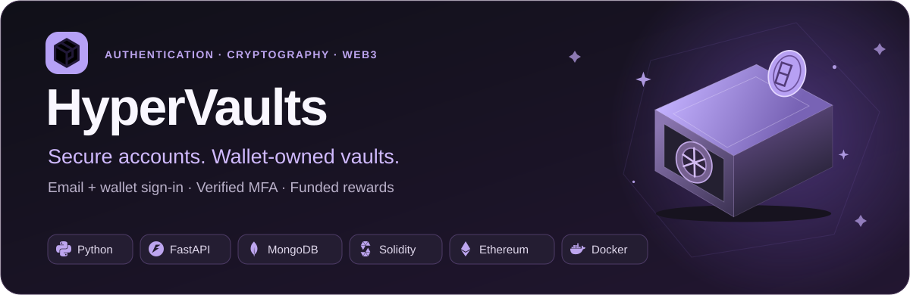
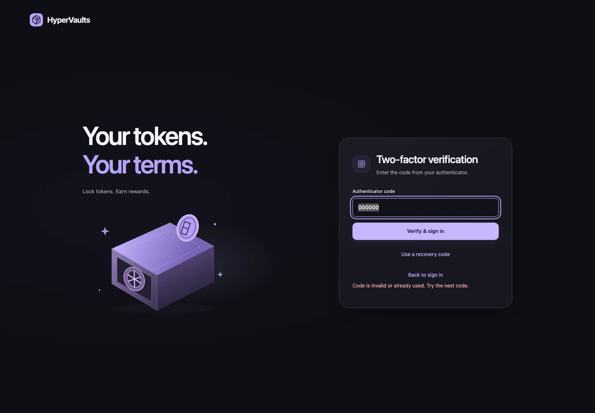
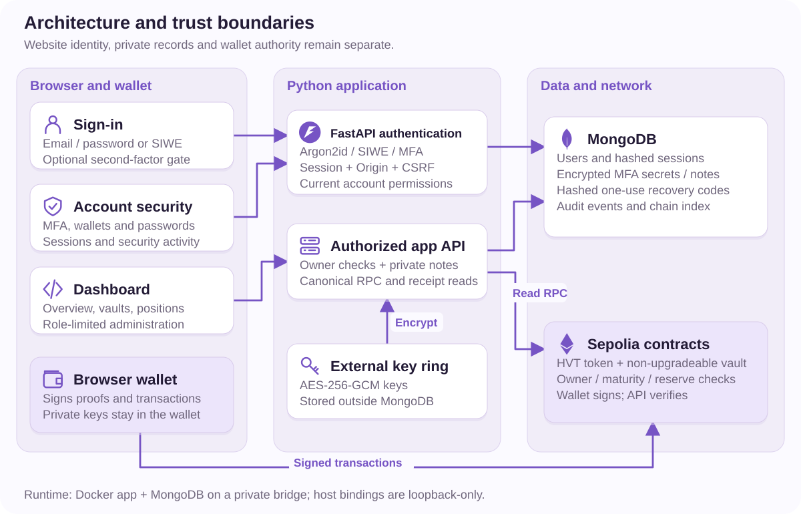
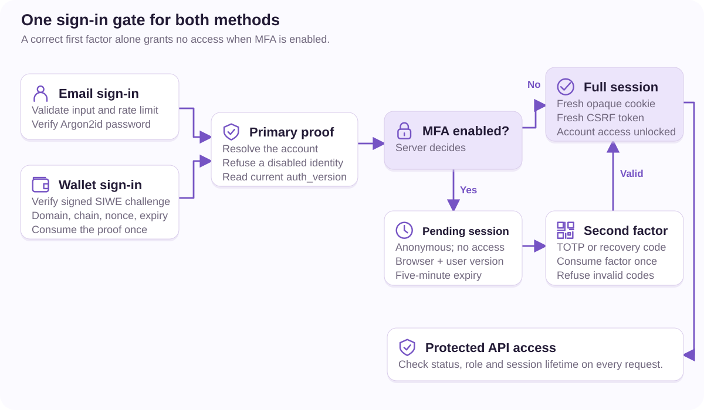
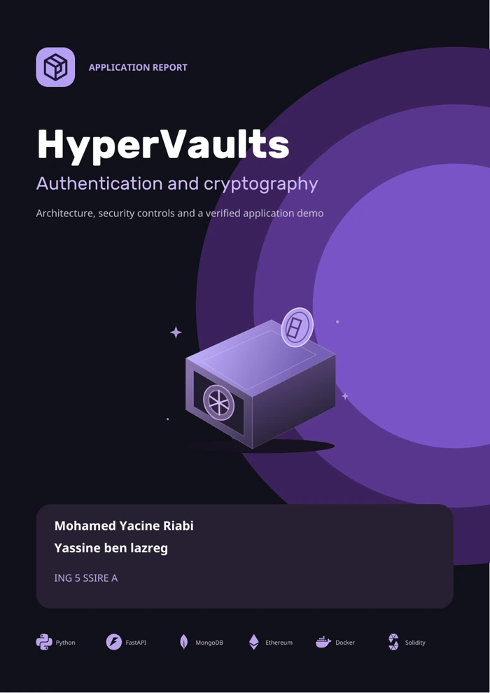

<p align="center">
  
</p>

<p align="center"><strong>💎 A clear journey from secure sign-in to wallet-owned positions.</strong></p>
<p align="center">
  <a href="#highlights">💎 Highlights</a> ·
  <a href="#quickstart">🚀 Quickstart</a> ·
  <a href="#product-tour">🖼️ Demo</a> ·
  <a href="#architecture">🧩 Architecture</a> ·
  <a href="#security">🔐 Security</a> ·
  <a href="#report">📖 Report</a>
</p>

HyperVaults combines email and wallet authentication, optional authenticator MFA,
encrypted private notes, and Solidity vaults with sponsor-funded rewards.
The wallet signs financial actions; the website manages identity and verifies
confirmed chain state. Built with plain HTML, CSS and JavaScript, with no frontend build step.


<a name="highlights"></a>
## 💎 Highlights

| A simple experience | The control behind it |
|---|---|
| **Email or wallet sign-in** | Argon2id password hashes and bound, one-use Sign-In with Ethereum proofs. |
| **Connect → Link → Ready** | Available wallets are discovered automatically; connecting alone does not claim account ownership. |
| **Scan to set up MFA** | Locally generated QR, verified activation, replay-resistant TOTP and eight one-use recovery codes. |
| **A separate Security page** | Manage wallets, email/password, MFA, active sessions and security activity outside the dashboard. |
| **Review before signing** | Exact token allowance, signer, contracts and offer terms shown before the wallet sends a transaction. |
| **Funded rewards and private notes** | The full reward is reserved on-chain; account-owned notes use context-bound AES-256-GCM encryption. |

<a name="quickstart"></a>
## 🚀 Quickstart

Install [uv](https://docs.astral.sh/uv/getting-started/installation/), use Python
3.12 or newer, and start Docker. The setup verifies its pinned contract toolchain.

```sh
git clone https://github.com/yacrb/Hypervaults.git
cd Hypervaults
uv sync --frozen
uv run python manage.py up
```

Open **[HyperVaults →](http://127.0.0.1:8088/login)** and create an account.
A fresh checkout starts Anvil, MongoDB, three offers and a funded reserve.
Repeating startup preserves the selected network, accounts, deployment and keys.

<details>
<summary>🛠️ Local demo account, wallet setup and useful commands</summary>

**Local Anvil demo administrator:** `admin@hypervaults.com` · password `admin`.
This public preset is limited to loopback development; setup refuses production
or remote-database seeding and preserves customized accounts.

Use a fresh test wallet. Anvil uses RPC `http://127.0.0.1:8545`, chain **31337**
and currency **ETH**. The wallet picker shows available providers and offers
installation links when none are present.

```sh
uv run python manage.py fund-gas --address YOUR_PUBLIC_TEST_WALLET_ADDRESS
uv run python manage.py advance 604800   # Local Anvil only: advance seven days
uv run python manage.py status
uv run python manage.py down
```

The app, Anvil and MongoDB ports **8088 / 8545 / 27018** bind to localhost.
Preserve `.env`, `.local` and Docker volumes: they hold private configuration,
encryption keys and chain state. A mismatched deployment fails verification
instead of silently resetting the chain.

For local HTTPS, run `uv run python manage.py up --https`, manually trust
`.local/tls/ca.pem`, then visit `https://localhost:8443`.

</details>

### 🌐 Use Sepolia

Deploy with your browser wallet and Sepolia test ETH:

```sh
uv run python manage.py sepolia --owner YOUR_PUBLIC_TEST_WALLET_ADDRESS
```

Open `http://127.0.0.1:8090/`, review the seven deployment/funding transactions,
then activate after verification. The backend never requests a private key.
Sepolia uses six confirmations and real elapsed lock periods. Existing local
state is preserved. See the [Sepolia deployment and restart guide](docs/SEPOLIA.md).

<a name="product-tour"></a>
## 🖼️ Product tour

<table>
  <tr>
    <td width="50%"><strong>🔑 Sign in</strong><br>Discover your wallet or use email.<br><a href="docs/assets/login.webp"></a></td>
    <td width="50%"><strong>💎 Choose a vault</strong><br>Compare terms and review your deposit.<br><a href="docs/assets/vaults.webp"></a></td>
  </tr>
  <tr>
    <td width="50%"><strong>🔐 Complete MFA</strong><br>Verify with an authenticator or recovery code.<br><a href="docs/assets/mfa.webp"></a></td>
    <td width="50%"><strong>🛡️ Administration</strong><br>Inspect funding, offers and account access.<br><a href="docs/assets/admin.webp"></a></td>
  </tr>
</table>

<details>
<summary>📱 See the mobile position view</summary>

<p align="center"></p>

Exact amounts, maturity, encrypted notes and settlement remain accessible on narrow screens.

</details>

These are real browser captures from a disposable Anvil/MongoDB demo. Registration,
linking, deposits and withdrawal used the actual app and contracts. The test wallet
was a bridge to isolated unlocked accounts; the temporary chain and accounts were
deleted after the run. No balances or transaction results were invented.

<a name="architecture"></a>
## 🧩 Architecture



**The browser presents the flow. FastAPI enforces website access. Solidity enforces
position ownership and maturity.** MongoDB stores identity/session records,
encrypted secrets, audit activity and the chain index. Encryption keys stay outside
the database, and wallet signing authority stays with the wallet.

Rewards come from a prefunded sponsor reserve. Each deposit reserves its entire
reward; existing positions retain their original terms. The server verifies the
canonical receipt, confirmation depth, signer, destination and matching contract
event before accepting a transaction as complete.

| Authority | What it can do |
|---|---|
| **Member** | Manage their account, linked-wallet positions, private notes and sessions. |
| **Website administrator** | Manage website users, roles and activity through protected APIs. |
| **Contract owner wallet** | Change future offers and pause new deposits; website controls also require an admin account. |
| **Position owner wallet** | Withdraw its matured position, once, even while deposits are paused. |

Website roles never grant another wallet's withdrawal rights.

<a name="security"></a>
## 🔐 Authentication and security

Email sign-in creates a website session. The dashboard then guides the member
through **Connect → Link → Ready**; a signed ownership proof links the wallet.
Wallet-first members can add email/password after recent wallet reauthentication.
Both methods use the same account and the same enabled MFA gate.

| Boundary | Implemented controls |
|---|---|
| **Credentials** | Argon2id hashing, strict input validation and IP/identity guessing limits. |
| **Sessions** | Opaque server-side tokens, rotation, idle/absolute expiry, revocation and current account/version checks. |
| **Browser requests** | Exact Origin plus CSRF validation, HttpOnly/Strict cookies, security headers and HTTPS cookie configuration. |
| **Second factor** | Anonymous pending session until MFA succeeds; atomic one-use factors and action-bound setting changes. |
| **Stored data** | AES-256-GCM, reserved nonces and associated data bound to account, purpose and record. |
| **Permissions** | Server-side roles and record ownership, independent of hidden buttons or navigation. |

<details>
<summary>Follow the security flows visually</summary>



[Wallet linking](docs/assets/security/wallet-linking.svg) ·
[Session lifecycle](docs/assets/security/sessions.svg) ·
[MFA enrollment](docs/assets/security/mfa-enrollment.svg) ·
[Encryption](docs/assets/security/encryption.svg) ·
[Authorization](docs/assets/security/authorization.svg) ·
[Transaction verification](docs/assets/security/transactions.svg) ·
[Implementation steps](docs/assets/security/security-steps.svg)

</details>

Read the [authentication guide](docs/AUTHENTICATION.md) and
[security boundaries](SECURITY.md) for the exact flows and limitations.
MFA is optional, email ownership verification is not implemented, and public
HTTPS/SMTP deployment still needs validation. HVT is an unpriced test token;
the project is unaudited and is not ready for real funds.

## 🧪 Recorded validation

| Check | Verified result |
|---|---|
| Python API and algorithms | **54 passed** — authentication, sessions, permissions, MFA, encryption and setup guards. |
| Solidity behavior | **16 passed**, including **512 fuzz inputs** for reward arithmetic. |
| Full browser journey | **4 real disposable-chain transactions**, both MFA sign-in methods, administrator views and **0 page errors**. |
| Responsive layouts | **20 checks** across five pages at 1440, 768, 375 and 320 pixels. |
| MFA QR | Independently decoded at four widths, then used to enable MFA through the real API. |
| Runtime dependencies | **61 packages checked; 0 known advisories** in the recorded audit. |
| Running Sepolia deployment | Read-only checks passed: three offers and covered reserves, plus website sign-in/out and account-security controls. |

These are recorded results for the report snapshot, not live CI badges or a claim
of an independent audit. [Raw evidence and scope →](docs/report/evidence/README.md)

<details>
<summary>🔬 Reproduce the main checks</summary>

Start local MongoDB through the usual setup, then run from the repository root:

```sh
HV_AUTH_TEST_MONGO_URI=mongodb://127.0.0.1:27018 \
  uv run python -m unittest discover -s tests -v
.tools/bin/forge test --root smartcontract --fuzz-runs 512 -vv
HV_AUTH_TEST_MONGO_URI=mongodb://127.0.0.1:27018 \
  uv run --with playwright python -m tests.check_app_e2e
```

The browser harness creates and cleans up its own Anvil container and MongoDB
database. It does not reset saved deployments or alter existing users.
See [all report checks and reproduction requirements](docs/report/README.md).

</details>

<a name="report"></a>
## 📖 Security report and documentation

<table>
  <tr>
    <td width="30%" align="center"><a href="docs/report/HyperVaults_Report.pdf"></a></td>
    <td><strong>Architecture. Authentication. A verified demo.</strong><br><br>A 23-page illustrated report with nine editable diagrams, actual demo screenshots, negative security cases, design decisions and remaining improvements.<br><br>💎 <a href="docs/report/HyperVaults_Report.pdf">Read the report</a><br>🧩 <a href="docs/assets/security">Browse the diagrams</a><br>🧪 <a href="docs/report/evidence/README.md">Inspect the evidence</a><br>🛠️ <a href="docs/report/README.md">Reproduce the report</a></td>
  </tr>
</table>

| Guide | Purpose |
|---|---|
| [Authentication](docs/AUTHENTICATION.md) | Email/wallet identity, linking, MFA, recovery and account controls. |
| [Architecture diagrams](docs/assets/security) | Services, contracts, identity flows and deployment boundaries. |
| [Application walkthrough](docs/report/HyperVaults_Report.pdf) | Registration, linking, MFA, deposits, private notes and settlement. |
| [Sepolia setup](docs/SEPOLIA.md) | Wallet-approved deployment, resumable setup and network operations. |
| [Security](SECURITY.md) | Threat model, implemented safeguards and production limitations. |

<details>
<summary>📂 Repository map</summary>

```text
auth/           Identity, MFA, sessions and account permissions
webapp/         API, chain verification, pages and browser assets
smartcontract/  Solidity vault/token and pinned dependencies
tests/          API, browser, network and security checks
docs/           Guides, report, diagrams and recorded evidence
scripts/        Browser-wallet Sepolia deployment helper
manage.py       Local startup and development controls
```

Wallet keys, credentials, runtime state and generated caches stay outside Git
and the app image.

</details>

<p align="center">Built by <strong>Mohamed Yacine Riabi</strong> and <strong>Yassine ben lazreg</strong></p>

<details>
<summary>🎨 Artwork credits</summary>

Hero artwork uses the app's own logo and vault illustration. Technology marks
come from [Simple Icons](https://github.com/simple-icons/simple-icons); see the
[artwork notice](docs/report/logos/NOTICE.md). Wallet artwork comes from
[MetaMask](https://metamask.io/assets) and
[Rabby](https://github.com/RabbyHub/Rabby/blob/develop/src/ui/assets/rabby.svg).
Vendored license notices remain alongside the assets. All README screenshots and
diagrams are served from this repository.

</details>
