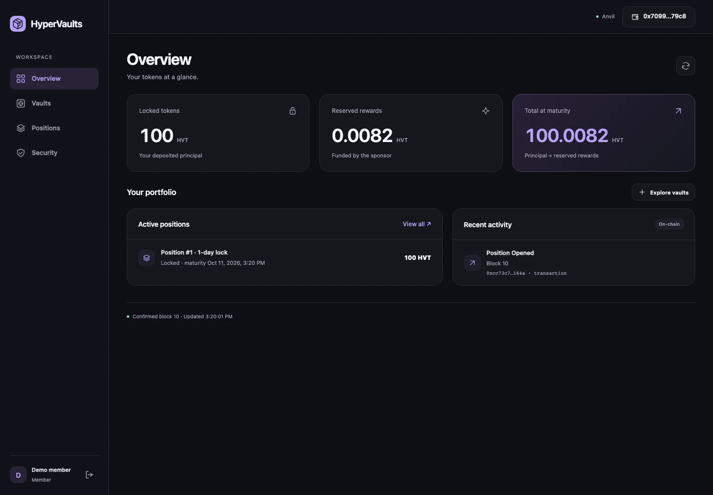
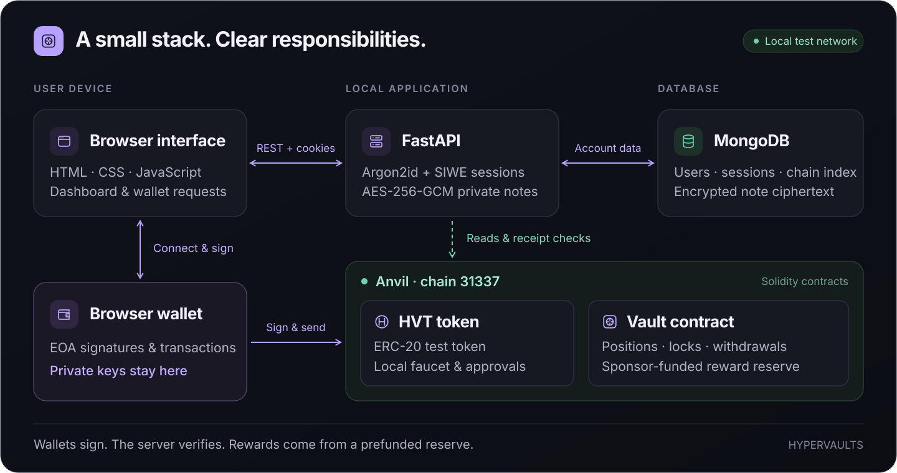
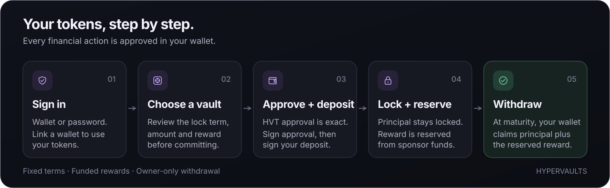
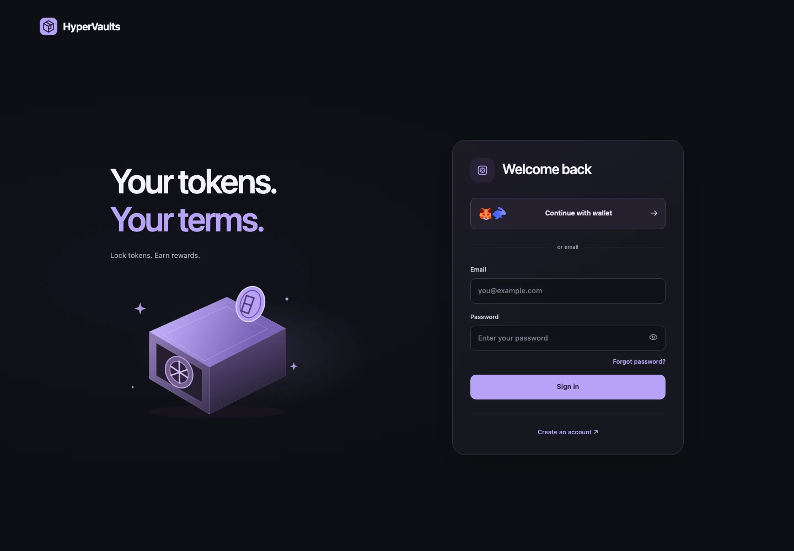
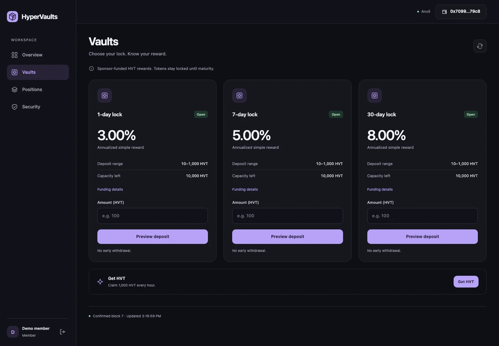
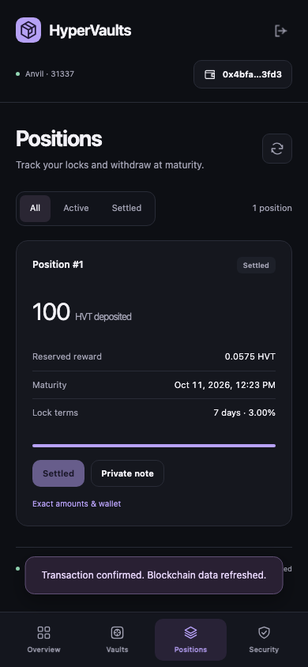
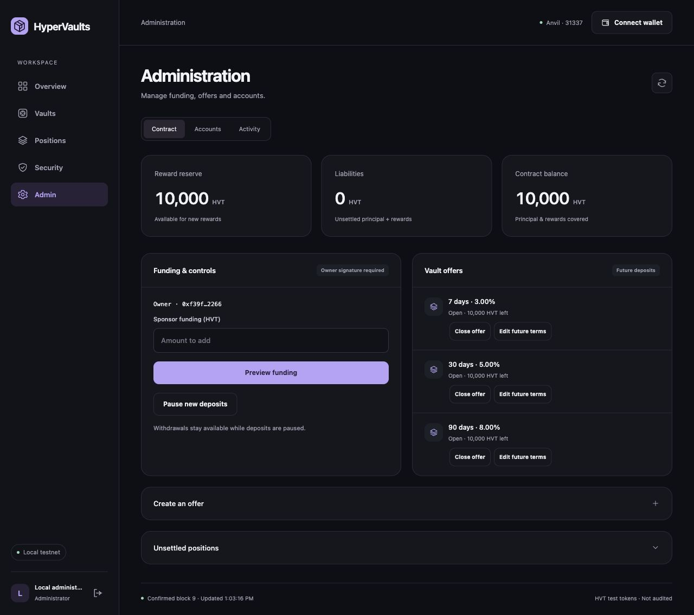

<p align="center"></p>
<h1 align="center">HyperVaults</h1>
<p align="center">Lock test tokens. Track funded rewards. Withdraw at maturity.</p>
<p align="center"><strong>FastAPI · MongoDB · Solidity · Anvil</strong><br>Plain HTML, CSS and JavaScript. No frontend build step.</p>
<p align="center"><a href="#run-locally">Quickstart</a> · <a href="#how-it-works">Architecture</a> · <a href="#screens">Screens</a> · <a href="#roles">Roles</a> · <a href="SECURITY.md">Security</a></p>



**HVT is an unpriced test token. This project is not audited or intended for real funds.**
The overview and position captures use disposable local test wallets with real Anvil
transactions. The remaining captures show the running local app. No balances were
added to the screenshots; demo transactions were reverted after the test run.

## Run locally

Install [uv](https://docs.astral.sh/uv/getting-started/installation/) and start Docker.

```sh
git clone https://github.com/yacrb/Hypervaults.git
cd Hypervaults
uv sync --frozen
uv run python manage.py up
```

Open **[HyperVaults](http://127.0.0.1:8088/login)**. Startup creates the contracts,
three vault offers, a funded reserve and the local demo administrator.

**Demo login:** `admin@hypervaults.com` · password `admin`

This public preset is for local Anvil development only. Setup refuses production
or a remote database. Repeating startup preserves your deployment, accounts,
password changes and keys. Ports **8088 / 8545 / 27018** bind only to localhost.
Encryption keys and private runtime files stay outside Git.

## How it works



The wallet signs transactions; the backend reads the chain and verifies receipts.
Rewards come from a prefunded sponsor reserve. Each deposit reserves its entire
reward, and existing positions keep their original terms.



1. **Sign in** with a wallet or email. Email users link their wallet in **Security**.
2. **Get test tokens** in **Vaults**, review an offer and preview a deposit.
3. **Track the position** and withdraw after maturity. Private notes are encrypted on the server.

Wallet connection requests **Anvil (31337)** and offers to add it when missing.
Approve the network request and sign-in message in your wallet. Signing in costs
no gas; transactions need local test ETH. Only injected EOA wallets are supported.

## Screens

<details>
<summary>Explore sign-in, vaults, positions and administration</summary>

**Sign in** — wallet discovery with MetaMask/Rabby artwork, or email and password.



**Vaults** — compare lock periods, view sponsor-funded rewards and preview deposits.



**Positions** — exact amounts, maturity, private notes and settlement, including on mobile.



**Admin** — separate tabs for contract controls, website accounts and activity.
Contract changes require the authorized wallet's signature.



</details>

## Roles

Your website role appears under your name in the desktop sidebar.

| Access | Location | Permission |
|---|---|---|
| **Member** | Overview · Vaults · Positions · Security | Manage your own positions, wallets and account. |
| **Administrator** | Admin → Accounts / Activity | Manage website users, roles and sessions. |
| **Contract owner** | Admin → Contract | Sign changes to future offers and pause new deposits. |

The **Admin** navigation appears for administrators. In **Accounts**, a user's
**⋯** menu contains **Make administrator**. Website roles and contract ownership
are separate: using contract controls here requires an administrator account and
the owner's wallet. Neither grants access to another wallet's tokens.
Sponsor funding is open to wallets, while offer and pause controls require the owner.

<details>
<summary>Local wallet setup and useful commands</summary>

Use a fresh test wallet. Manual Anvil settings: RPC `http://127.0.0.1:8545`,
chain **31337**, currency **ETH**. Install links appear when a wallet is missing.

```sh
uv run python manage.py fund-gas --address YOUR_TEST_WALLET_ADDRESS
uv run python manage.py advance 604800   # Advance only the local chain by seven days
uv run python manage.py status
uv run python manage.py down
```

To nominate a linked wallet as contract owner:

```sh
uv run python manage.py nominate-owner --address YOUR_LINKED_TEST_WALLET
```

That wallet accepts in **Admin → Contract** while signed in as a website administrator.
Keep `.env`, `.local` and Docker
volumes: they hold local keys, credentials and chain state.

For local HTTPS, use `uv run python manage.py up --https`, manually trust
`.local/tls/ca.pem` in your test browser and visit `https://localhost:8443`.
Return to HTTP with `uv run python manage.py up`. Local recovery messages are in
`.local/outbox`. See [SECURITY.md](SECURITY.md) for the trust boundaries and limitations.

</details>

## Repository

```text
auth/           Authentication, sessions and account permissions
webapp/         API, chain reads, templates and browser assets
smartcontract/  Vault/token source and pinned Foundry dependencies
docs/assets/    Two editable diagrams and five app screenshots
manage.py       Local startup and development controls
```

The runtime repository contains no test suites, demo scripts or engineering reports.
Optional development material is preserved separately in the local
`../Hypervaults-development-archive/` folder. It is not required to run the app.
Wallet keys, credentials, caches and generated build output are excluded from Git
and the app image. Wallet-extension prompts and public Sepolia deployment remain unverified.

<details>
<summary>Artwork and dependency credits</summary>

Wallet artwork: [MetaMask brand assets](https://metamask.io/assets) and
[Rabby's repository](https://github.com/RabbyHub/Rabby/blob/develop/src/ui/assets/rabby.svg).
The interface serves all artwork and scripts locally. Vendored ethers and Rabby
license notices are included alongside their assets. README diagrams use the
interface's local icon shapes and contain no external resources.

</details>
