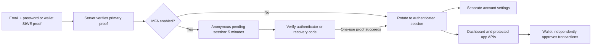

# Authentication and account security

## Using two-factor authentication

Open **Security → Set up authenticator**, confirm your identity, then add the
displayed setup key to your authenticator using manual entry. Enter its six-digit
code to enable protection. Download the eight recovery codes before leaving;
they are displayed once. Each recovery code works once.

Email and linked-wallet sign-in both ask for an authenticator code when enabled.
Choose **Use a recovery code** if your authenticator is unavailable. A code
already used to enable MFA or confirm another action cannot be reused; wait for
the next code. **Back to sign in** cancels the pending sign-in.

**New recovery codes** and **Turn off** ask for your password (or your linked
wallet's ownership signature) and an authenticator/recovery code. One confirmation
authorizes only that chosen change. New recovery codes invalidate the previous set.
MFA changes sign out other browsers; the browser making the change stays signed in.

Password recovery still requires MFA and keeps it enabled. Email recovery and
wallet ownership cannot remove MFA. Keep your recovery codes: there is no automatic
bypass if both your authenticator and all recovery codes are lost.

## Separation of responsibilities

| Area | Page and browser code | Responsibility |
|---|---|---|
| Sign-in | `auth.html`, `auth.js` | Email/wallet sign-in, registration, recovery, second-factor challenge. |
| Account | `/security`, `account.html`, `account.js` | Linked wallets, email/password setup, MFA, sessions and security activity. |
| Confirmation | `security.js` | Shared identity/factor dialogs, submission guards and cancellation. |
| Dashboard | `index.html`, `app.js` | Wallet onboarding, balances, vaults, positions and administration. |
| Server | `auth/services.py`, `auth/routes.py`, `auth/mfa.py`, `auth/mfa_routes.py` | Verify credentials and factors; enforce sessions and account changes. |

The account page has its own layout and module. It does not request vault
snapshots, read balances or prepare financial transactions. Password and MFA
controls work when wallet configuration is unavailable. Wallet authentication
needs the selected network and server wallet checks.



The server, rather than page visibility, decides access. A pending session has no
authenticated user or permissions. Every protected API resolves the current
account, authorization version and disabled/role state before allowing access.

## Storage and controls

- Passwords use Argon2id. Wallet proofs use browser-bound, expiring SIWE challenges
  verified against the selected network and signing address. Both sign-in methods
  pass through the same optional MFA gate.
- Cookies contain opaque random session identifiers; MongoDB stores their hashes.
  Sign-in and successful MFA rotate the identifier and CSRF token. Cookies are
  HttpOnly and SameSite=Strict; HTTPS also enables Secure cookies. Mutations require
  the configured Origin and current CSRF token.
- TOTP follows [RFC 6238](https://www.rfc-editor.org/rfc/rfc6238): a random 160-bit
  secret, SHA-1 HMAC, six digits and 30-second steps. The server permits one step
  of clock drift and atomically advances the last accepted step to reject replay.
- Secrets use AES-256-GCM with account and purpose binding. MFA enrollment has
  distinct authenticated context from private notes and a five-minute expiry.
  Both purposes use the external `HV_NOTE_KEYS` key ring and persistent nonce
  reservations. Retain old keys while notes or MFA secrets reference them.
- Each recovery code contains 128 random bits. Only SHA-256 hashes are stored;
  atomic removal makes each code single-use even under concurrent requests.
- MFA settings confirmations bind a full identity proof to one named action for
  60 seconds and are atomically consumed. Settings changes increment `auth_version`,
  revoke other sessions and invalidate reset/enrollment tokens.
- Identity/IP budgets limit password, wallet and factor attempts. API validation
  and audit events omit submitted passwords, setup secrets and recovery codes.
  Codes and setup keys are never sent to third-party QR services or browser storage.

MFA protects website access. A wallet can still transact directly on-chain;
website MFA cannot replace the wallet's own transaction approval or recovery rules.

## Reproducible checks

```sh
# RFC vectors, network and deployment checks; database checks skip unless selected.
uv run python -m unittest discover -s tests -v

# Adds real API and atomic Mongo checks in uniquely named disposable test databases.
HV_AUTH_TEST_MONGO_URI=mongodb://127.0.0.1:27018 \
  uv run python -m unittest discover -s tests -v

# Isolated browser fixtures: no existing accounts or wallet transactions change.
uv run --with playwright playwright install chromium
uv run --with playwright python tests/check_auth_ui.py
uv run --with playwright python tests/check_account_ui.py
```

| Security case | Expected result |
|---|---|
| Correct password or wallet proof, MFA unfinished | Anonymous pending session; protected account APIs return 401. |
| Wrong, expired or previously accepted authenticator code | Refused; no authenticated session created. |
| Simultaneous use of the same TOTP/recovery code | Exactly one verification succeeds. |
| Cancel, expire or switch browsers during pending sign-in | Pending proof grants no access. |
| Disabled account or changed authorization version | Pending sign-in cannot finish; old sessions fail. |
| Password reset or password/wallet reauthentication without enabled MFA | Refused; recovery link cannot bypass MFA. |
| Change MFA without identity confirmation, with the wrong action or after 60 seconds | Refused. |
| Missing CSRF token, repeated invalid factor guesses | Refused or rate-limited. |
| Enrollment ciphertext used as a note or for another account | GCM authentication fails; decryption refused. |
| Cancel a browser dialog or submit again while busy | No unintended mutation or duplicate request. |

These tests cover local algorithms, server/API controls, actual database atomicity
and isolated browser flows. They do not constitute an independent security audit
or a completed test on a user's physical authenticator.
