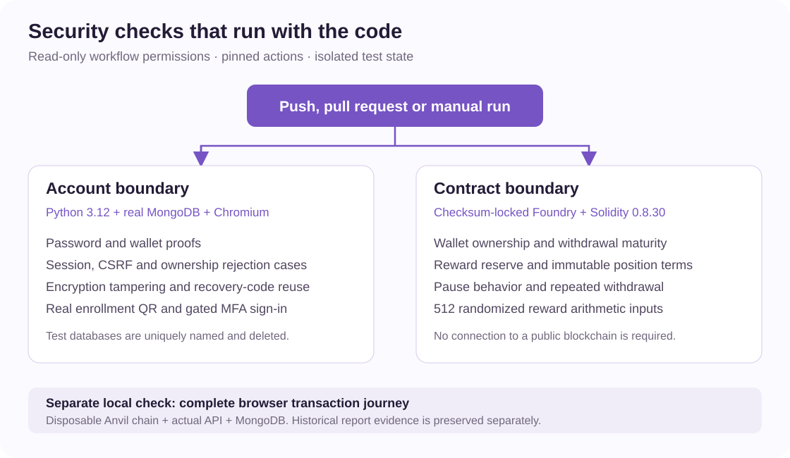
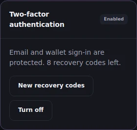

# Verify HyperVaults

[GitHub Actions](../.github/workflows/verify.yml) runs the existing security suites
on pushes and pull requests. Python checks use a real MongoDB service. Each test
creates and removes its own uniquely named database.



## Run the same checks locally

Install Python 3.12, uv and Docker, then run:

```sh
uv sync --frozen
docker compose up -d --wait mongo
HV_AUTH_TEST_MONGO_URI=mongodb://127.0.0.1:27018 \
  uv run python -m unittest discover -s tests -v
uv run python -c 'from manage import setup_dependencies; setup_dependencies()'
.tools/bin/forge test --root smartcontract --fuzz-runs 512 -vv
```

**Check the skipped count.** Without `HV_AUTH_TEST_MONGO_URI`, database-backed
authentication and authorization tests are skipped. That run checks only the
database-independent tests and does not validate the complete account system.

## Browser checks

```sh
uv run --with playwright==1.64.1 playwright install chromium
uv run --with playwright==1.64.1 python -m tests.check_auth_ui
uv run --with playwright==1.64.1 python -m tests.check_account_ui
HV_AUTH_TEST_MONGO_URI=mongodb://127.0.0.1:27018 \
  uv run --with playwright==1.64.1 python -m tests.check_mfa_e2e
```

The first two checks use controlled API fixtures for loading, cancellation and
error states. The MFA check uses the real API and database, independently decodes
the rendered QR at four widths, and keeps the blockchain offline. The screenshot
below records the enabled state after sign-in. It contains no enrollment QR,
authenticator secret or recovery codes.



For the separate full contract/browser journey, run
`HV_AUTH_TEST_MONGO_URI=mongodb://127.0.0.1:27018 uv run --with playwright==1.64.1 python -m tests.check_app_e2e`
after installing Docker and compiling the contracts. It starts its own Anvil
container. This complete transaction journey is not part of the two CI jobs.

## Recorded results

The [report evidence](report/evidence/README.md) preserves the original report's
results and screenshots. It is a historical snapshot. The Actions run for a
particular commit is the source for that commit's automated test status.
